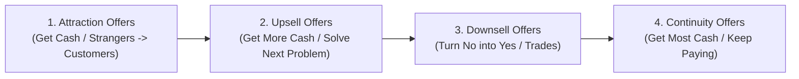

# $100M Money Models by Alex Hormozi — DMA Master Playbook

## Core Thesis: The 30-Day Cash Machine
A **Money Model** is a deliberate sequence of offers designed to increase how many customers you get, how much they pay, and how fast they pay it.
- **The Golden Metric:** A $100M Money Model makes more profit from a single customer in the first 30 days than it costs to acquire and service multiple customers.
- **The Core Rule:** A business is constrained by cash. When your front-end and upsells pay for customer acquisition in under 30 days (leveraging interest-free 30-day credit card float), growth becomes mathematically uncapped.

---

## SECTION I: ATTRACTION OFFERS (Turn Eyeballs into Money)
The goal of Attraction Offers is to turn strangers into paying customers and generate maximum upfront cash.

### 1. Win Your Money Back (The Accountability Wager)
- **Concept:** Customer pays upfront deposit (e.g. $500–$600). If they hit the goal or follow all instructions within a set time, they get their money back or store credit.
- **3 Criteria Options:**
  1. *Results-Based:* Lose 20 lbs, make $5,000. (They bet on themselves).
  2. *Action-Based:* Attend all calls, log daily homework, post weekly. (They bet on following directions).
  3. *Action + Results:* Must do the work AND hit the milestone.
- **The Million-Dollar Rollover Secret:** Do NOT give the money back in cash if they win. Apply their winnings as a **Store Credit Discount spread over a 12-month commitment** (e.g. $600 credit = $50/mo discount on a $200/mo membership $\to$ they pay $150/mo).
- **Let the "Losers" Win:** If someone fails the challenge, act like they won anyway: *"You met our goal by finishing what you started. I'll credit your entire deposit toward staying with us long-term."*

### 2. Giveaways & Partial Scholarships
- **Concept:** Advertise a Grand Prize (e.g., $10,000 scholarship or complete equipment bundle).
- **The Strategy:** One person wins the Grand Prize publicly. **Everyone else receives a private "Partial Scholarship" / Gift Card / Voucher** (a 10%–30% discount anchored against the massive Grand Prize value).
- **Referral Doubler:** Tell entrants: *"If someone you refer wins the Grand Prize, you win one too."* Entrants will recruit their friends endlessly.

### 3. Decoy Offers (The Turkey Talk)
- **Concept:** Advertise a dirt-cheap or free entry point (e.g. $5 VIP tanning pass, free workout session).
- **The Conversion Secret:** In the presentation, present the Decoy next to the **Ultimate Premium Version** ($399+).
- **The Permission Question:** *"Are you here for free stuff or lasting results?"* When they say results, skip the decoy and close the premium offer.

### 4. Buy X Get Y Free (The Boot Factory Play)
- **Concept:** Free offers convert vastly higher than percentage discounts.
- **The Pricing Anchor:** Instead of selling 3 shirts for $10 each ($30 total) or discounting 33%, charge **$30 for 1 shirt and give 2 shirts away for free**.
- **Service Application:** *"Buy 6 Months, Get 6 Months Free at $1,800 paid upfront."* It provides instant cashflow and keeps clients for a full year.

### 5. Pay Less Now or Pay More Later
- **Concept:** Remove all initial risk.
  - *Option A (Pay Later):* $0 down today. Tested for 3–14 days. Billed full price ($297–$500) at the end unless they cancel.
  - *Option B (Pay Now):* Pay a discounted rate ($97–$299) today and get exclusive recordings/bonuses.
- **Card On File:** Always get their card on file at registration.

---

## SECTION II: UPSELL OFFERS (Whatever We Offer Next)
When an offer solves a problem, a new problem immediately appears. Upsells solve that newly revealed problem.

### 1. The Classic Upsell ("You Can't Have X Without Y")
- Solves the next immediate logistical problem (e.g. Car wash $\to$ Sealant; Bicycle $\to$ Helmet; Exercise course $\to$ Nutrition course).
- **The "Say No to Say Yes" Close:** Ask: *"You don't want anything besides [X and Y], do you?"* Getting them to say "No" locks in the purchase.
- **Hyper-Buying Cycle:** Strike while motivation is peak—people spend the most money in the short window right after deciding to start a new journey.

### 2. Menu Upsell (Unselling & Prescribing)
- **The 4-Step Sequence:**
  1. *Unsell:* Cross out options they *don't* need to build instant trust.
  2. *Prescribe:* Explicitly tell them what they *must* do like a doctor.
  3. *A/B Alternative Close:* Never ask "Do you want this yes or no?" Ask: *"Do you prefer Option A or Option B?"* (Morning vs evening, chocolate vs vanilla, 1 bottle vs 2).
  4. *Card On File Close:* *"Do you want to just use the card on file?"*
- **The Economist Play (Decoy Pricing):**
  - Option A: Digital ($59)
  - Option B: Print ($125)
  - Option C: Digital + Print ($125) $\to$ Drives 85%+ into Option C.

### 3. Anchor Upsell ("The Gasp" & Come to the Rescue)
- **Concept:** Present an absurdly premium tier first (5x–10x price, e.g. $16,000 bespoke package).
- **The Gasp:** Expect the customer to panic at the price tag.
- **Come to the Rescue:** Immediately ask: *"Do you care about [extreme premium luxury feature]?"* When they say no, drape the $2,200 core offer over their shoulders. Compared to $16k, $2.2k feels like a relief.

### 4. Rollover Upsell ("Wanna Just Roll It Forward?")
- **Concept:** Credit 100% of past purchases toward an upgraded, higher-ticket package (priced at least 4x the credit).
- **Use Cases:**
  - *Rescue Upset Customers:* Turn a refund demand into a rollover upgrade.
  - *Steal Competitor Clients:* Credit whatever they owe their current provider if they switch to your contract.
  - *Winback Campaigns:* Reach out to clients from 6 months ago with a \$2,000–\$4,000 rollover credit voucher.

---

## SECTION III: DOWNSELL OFFERS (What to Offer When They Say No)
Downsells turn "Nos" into "Yeses" without destroying product value.

### Fundamental Downselling Rules:
1. **Downsells are Trades:** Never discount the exact same product for less money just because they objected. If you give something, take something away.
2. **Personalize, Don't Pressure:** Collaborate to find a deal that fits their budget.
3. **Temperature Check:** If they say no twice, ask: *"On a scale of 1–10, how bad do you want to fix this?"* If 8+, use Payment Plans. If $\le 7$, use Feature Downsells.

### 1. Payment Plan Downsells (How They Pay)
The 7-Step Downsell Ladder:
1. *Reward Pay-in-Full:* Price with interest baked in, then offer prepayment discount.
2. *3rd-Party Financing / Credit Card / Layaway.*
3. *Half Now, Half on Next Paycheck.*
4. *Temperature Check (1–10).*
5. *Split into 3 Payments.*
6. *Evenly Spread Weekly Payments.*
7. *Free Trial with Penalty.*

### 2. Trial With Penalty
- **Concept:** The customer starts for $0 today. They put their credit card down and agree to specific terms (attend 3 calls, do homework, log progress).
- **The Mechanism:** If they do the work, it stays free. If they skip sessions or fail to show up, they are charged the fee (e.g. $50 per missed meeting or $500 lump onboarding fee).
- **Why It Works:** Loss aversion forces adherence. Active students experience results and convert into long-term clients.

### 3. Feature Downsells (What They Get)
Lower the price by peeling away features:
- **Feature Downsell the Guarantee:** *"If you're okay waiving the money-back guarantee, I can knock $400 off right now."* (Most buyers realize they want the guarantee and buy full price).
- **Speed & Access:** Switch 1-on-1 to group; 5-minute response to 24-hour response; unlimited access to scheduled windows.
- **DFY to DIY:** Switch Done-For-You agency work to templates and self-study systems.
- **"The Minimum" Package:** Name the bottom tier "The Minimum" so customers psychologically want to upgrade.

---

## SECTION IV: CONTINUITY OFFERS (Keep Them Buying for Good)
Continuity compounds cashflow and removes the stress of starting at zero every month.

### 1. Continuity Bonus Offers
- Give away a high-value asset ($500–$1,000 standalone value) **100% free if they join the monthly membership today**.
- Anchor the bonus first, then make continuity the only way to unlock it.

### 2. Continuity Discount Offers
- Give free months in exchange for a contract commitment (e.g., 3 months free on a 12-month contract).
- **The 4 Spread Methods:** Frontload (free at start), Backload (earn free months at end), Spread evenly ($50 off each month), or after first 1–2 payments.
- **The 4-Week Billing Secret:** Bill every 4 weeks (13 billing cycles/year) instead of monthly (12 cycles). Produces an automatic **+8.3% increase in annual revenue** for zero extra work.
- **Cancellation Fee Rule:** Make the early cancellation fee equal to the discount they received by committing.

### 3. Waived Fee Offers
- Quote a massive setup fee (3x–5x monthly rate, e.g. $5,000 setup + $1,000/mo).
- Offer: *"I will waive the entire $5,000 setup fee if you commit to 12 months."*
- If they break the contract early, they must pay the waived setup fee.

---

## SECTION V: THE 3-STAGE EVOLUTION OF A MONEY MODEL
Never build all 4 offers at once on day one. Build sequentially:

1. **Stage I (Get Cash):** Perfect one **Attraction Offer** until customer acquisition cost (CAC) is paid back within 30 days.
2. **Stage II (Get More Cash):** Stack **Classic & Menu Upsells** + **Payment Plan / Feature Downsells** to generate 2x–5x profit per lead.
3. **Stage III (Get The Most Cash):** Introduce **Continuity & Waived Fees** to build long-term recurring equity.

